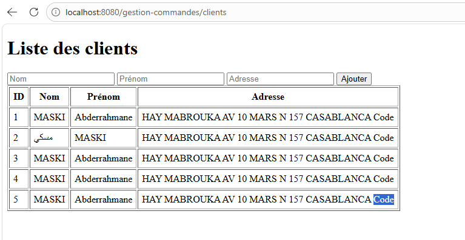
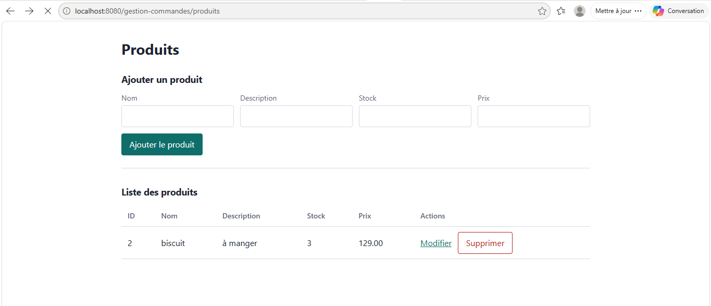
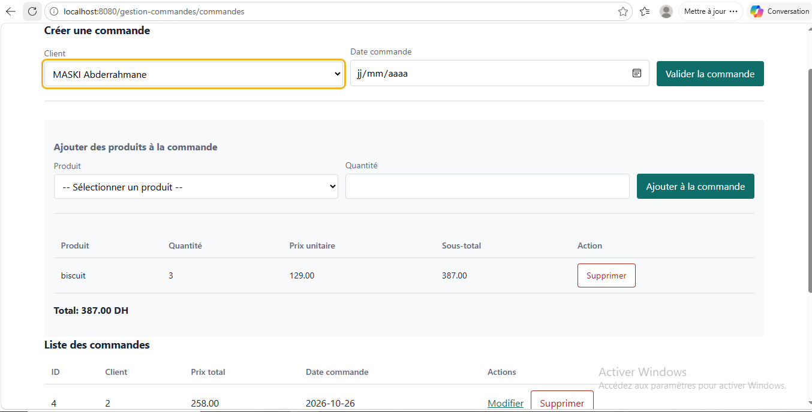

# Gestion des commandes (JEE : Servlet, JSP, JSTL)

Atelier JEE du cycle ingénieur LSI, FST Tanger (Université Abdelmalek Essaadi).
Application web de gestion de clients, produits et commandes, basée sur le patron MVC avec les standards JEE (Servlet, JSP, JavaBean) et JDBC.

## Technologies
Java 21, Maven, Tomcat 10.1 (Jakarta Servlet 6.0), JSP + JSTL, PostgreSQL, dotenv-java.

> Le sujet mentionne MySQL ; ce projet utilise PostgreSQL. Le script SQL fourni crée le schéma.

## Fonctionnalités
- Espace client : liste, ajout, modification, suppression
- Espace produit : liste, ajout, modification, suppression
- Espace commande : [décris ce que fait ton espace commande]

## Structure
```
src/main/java/ma/fstt/
├── entities   # JavaBeans (Client, Produit, Commande, LigneCommande)
├── dao        # accès aux données en JDBC
├── service    # interface générique IDao
├── servlets   # contrôleurs
└── util       # DBConnection
src/main/webapp/WEB-INF/views   # pages JSP
sql/schema.sql                  # création des tables
```

## Installation
1. Créer la base : `CREATE DATABASE "gestion-commandes";`
2. Exécuter `sql/schema.sql` sur cette base.
3. Copier `src/main/resources/.env.example` en `src/main/resources/.env` et renseigner `DB_URL`, `DB_USER`, `DB_PASSWORD`.
4. Lancer avec IntelliJ (Smart Tomcat, Tomcat 10.1, context path `/gestion-commandes`), ou construire le `.war` avec `mvn clean package` et le copier dans le dossier `webapps` de Tomcat 10.1.
5. Ouvrir `http://localhost:8080/gestion-commandes/clients`.

## Captures d'écran de l'application:
[ajoute 3 ou 4 images dans un dossier docs/ et référence-les ici]



## 👤 Auteur

**Abderrahmane Maski**
Élève ingénieur — Génie Logiciel et Systèmes Intelligents
Faculté des Sciences et Techniques de Tanger

[LinkedIn](https://www.linkedin.com/in/abderrahmane-maski-4a46262b9) • [GitHub](https://github.com/abdoumaski04-collab)